<p align="center">
  <picture>
    <source media="(prefers-color-scheme: dark)" srcset="docs/assets/readme/logo-ring-white.svg">
    
  </picture>
</p>

<h1 align="center">Sukoon</h1>

<p align="center">
  A calm, fast home screen for Android TV and Google TV.<br>
  It clears out the bloat, keeps everything you use, and shows the lyrics of whatever is playing.
</p>

<p align="center">
  <a href="https://github.com/MultiX0/sukoon-tv/releases/latest"></a>
  
  
</p>

<p align="center">
  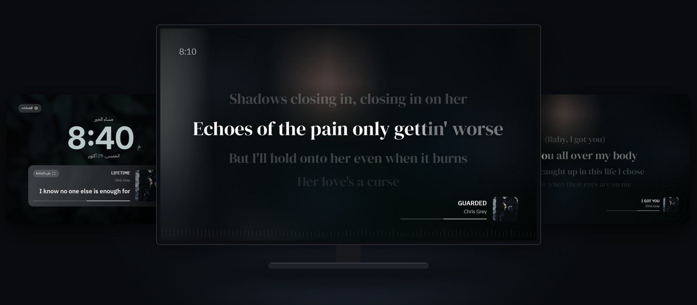
</p>

Most TV boxes and smart TVs ship with a home screen full of ads, rows of shows you never asked for, and a dozen
background services that eat the little memory they have. Sukoon replaces that home screen with a quiet one you
can shape, and turns the extras off. Nothing is uninstalled and nothing needs root, so every change can be undone.

On the box it was built on (a 2 GB Android TV 10 box), turning the extras off cut the memory in use from 621 MB to
521 MB after a reboot, and Sukoon's home screen uses 27 MB where the Google TV one used 38.5 MB.

## Contents

- [Before you start: turn on debugging](#before-you-start-turn-on-debugging)
- [Way 1: let an AI agent install it](#way-1-let-an-ai-agent-install-it)
- [Way 2: install it yourself](#way-2-install-it-yourself)
- [Supported TVs and boxes](#supported-tvs-and-boxes)
- [What you get](#what-you-get)
- [Updates](#updates)
- [Permissions and privacy](#permissions-and-privacy)
- [Undo everything](#undo-everything)

## Before you start: turn on debugging

Both ways install Sukoon from a computer, over your home network (or a USB cable for boxes that have a USB port).
For that, the TV has to allow it once. This takes about two minutes with the remote. Menu names differ a little
between brands; the [table below](#supported-tvs-and-boxes) lists where they are on each one.

| | | |
|:-:|:-:|:-:|
| 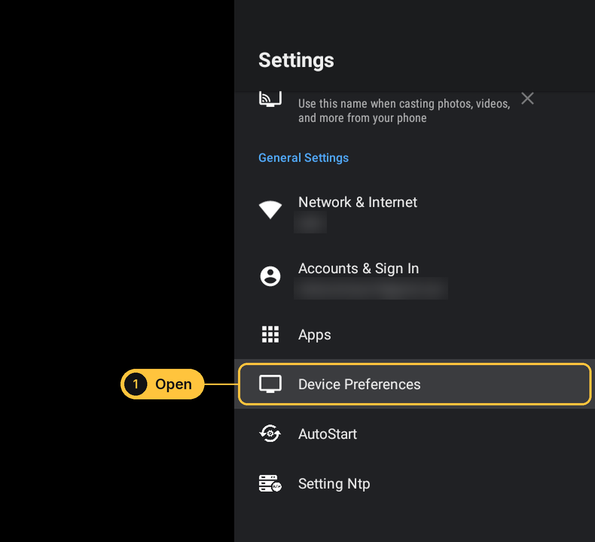 | 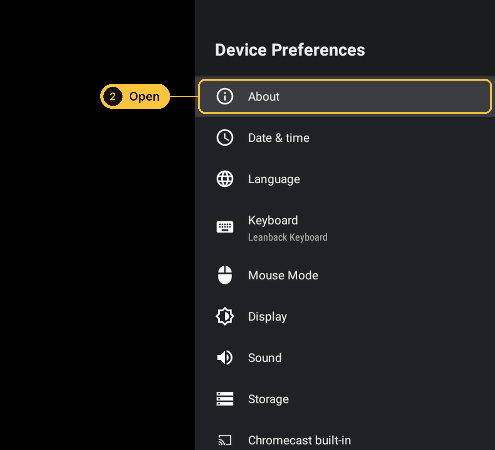 | 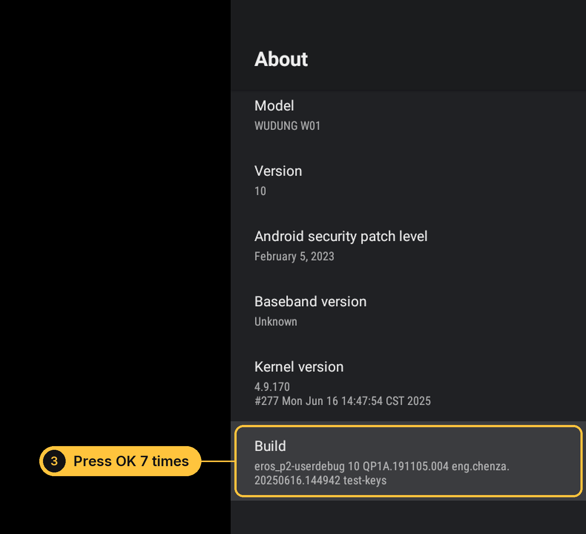 |
| **1.** Open **Settings**, then **Device Preferences**. On Google TV: **Settings**, then **System**. | **2.** Open **About**. | **3.** Select **Build** (Google TV: **Android TV OS build**) and press **OK 7 times**, until the TV says you are a developer. |
| 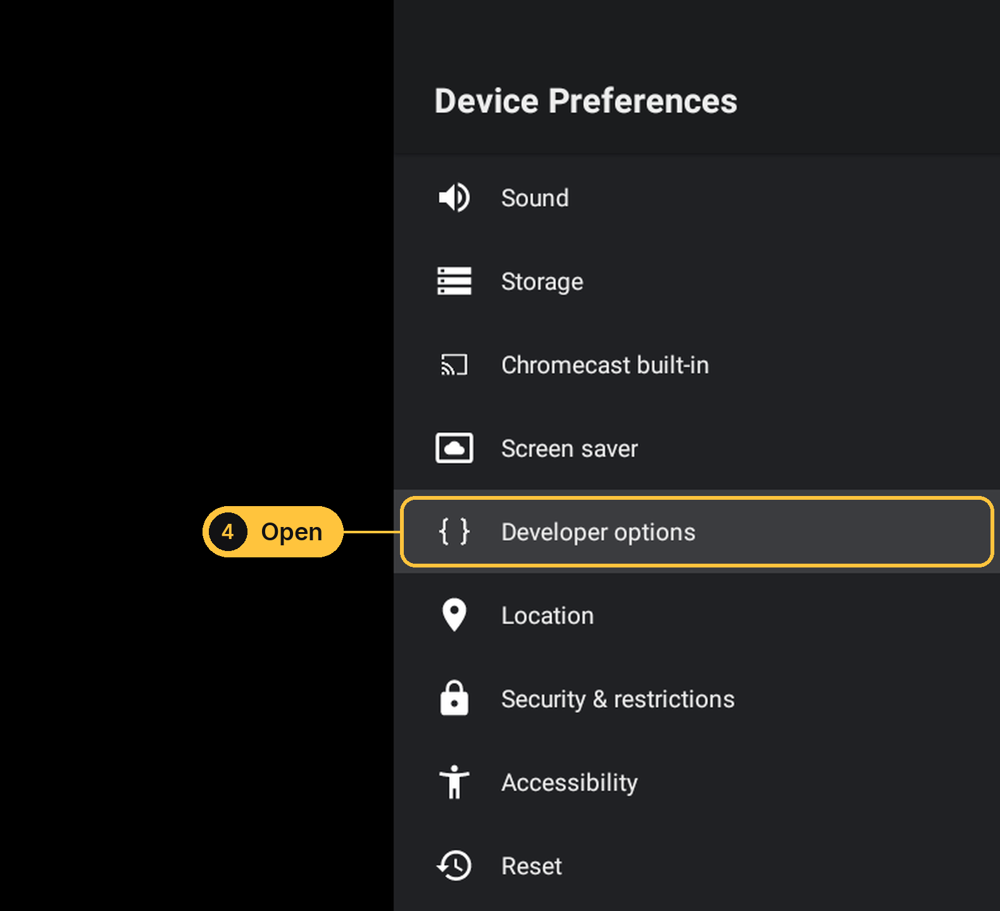 | 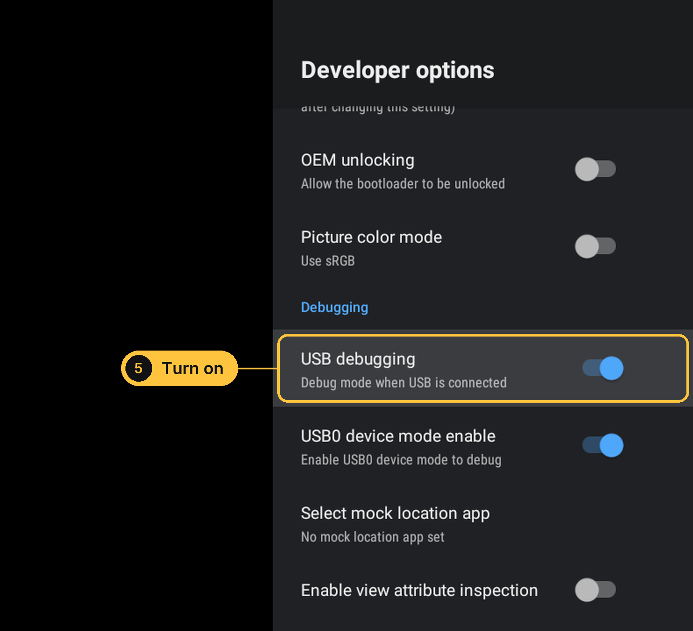 | 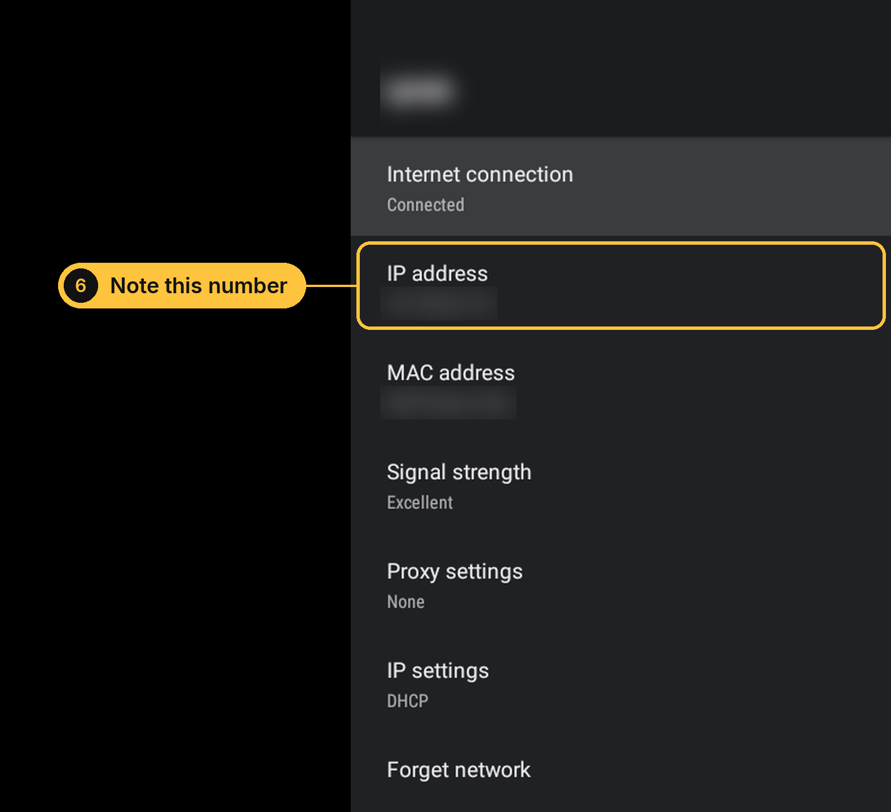 |
| **4.** Go back one screen and open **Developer options** (now at the bottom). | **5.** Turn on **USB debugging**. If you see **Network debugging** or **Wireless debugging**, turn that on too. | **6.** Go to **Settings**, **Network & Internet**, select your Wi-Fi, and note the **IP address** (it looks like `192.168.1.20`). |

## Way 1: let an AI agent install it

The easiest way. A coding agent such as [Claude Code](https://docs.anthropic.com/en/docs/claude-code/overview) or
[Codex](https://github.com/openai/codex) runs on your computer, looks at your TV first, shows you what it plans to
change, and only goes ahead when you say yes. It works on any of the TVs below, including ones this project has
never seen, because it reads your TV's own app list instead of guessing.

1. Install Claude Code or Codex using the link above, then open a terminal (on Windows: PowerShell) and start it with
   `claude` or `codex`.
2. Copy this message, put your TV's IP address in the first line, and paste it in:

   ```text
   My Android TV is on my network at 192.168.1.20 with debugging turned on. Install the Sukoon launcher on it
   from github.com/MultiX0/sukoon-tv and follow the steps in that repository's PROMPT.md. Install adb first if
   this computer doesn't have it. Ask me before you change anything on the TV.
   ```

3. The TV will show **Allow debugging?** Tick **Always allow from this computer** and press **OK**.
4. The agent lists what it wants to turn off, with a reason for each app. Read it, then answer yes (or tell it what
   to keep). It installs Sukoon, makes it the home screen, turns the extras off and shows you the memory before
   and after.

The full prompt it follows is in [PROMPT.md](PROMPT.md); you can also paste that file directly.

## Way 2: install it yourself

Every step is one command. Copy it with the button at the top right of each box.

**1. Install ADB** (the tool that talks to the TV). Pick your computer:

Windows (PowerShell). Close and reopen PowerShell after it finishes:

```powershell
winget install Google.PlatformTools
```

macOS (with [Homebrew](https://brew.sh)):

```bash
brew install android-platform-tools
```

Linux (Debian, Ubuntu):

```bash
sudo apt install adb
```

**2. Connect to the TV.** Use the IP address from step 6:

```bash
adb connect 192.168.1.20:5555
```

If it says the connection was refused and your TV has no Network or Wireless debugging option (many Android 10
boxes), connect it once with a USB cable and run `adb tcpip 5555`; after that the line above works until the next
restart.

The TV shows **Allow debugging?**: tick **Always allow from this computer** and press **OK**. Then check that the
TV is listed as `device`:

```bash
adb devices
```

On a TV with **Wireless debugging** (Android 11 and newer, most Google TVs), open that menu, choose
**Pair device with pairing code**, and use the address and code it shows instead:

```bash
adb pair 192.168.1.20:37000
```

```bash
adb connect 192.168.1.20:41000
```

**3. Download Sukoon and install it.** Download it on Windows (PowerShell):

```powershell
curl.exe -L -o sukoon.apk https://github.com/MultiX0/sukoon-tv/releases/latest/download/sukoon-launcher.apk
```

or on macOS and Linux:

```bash
curl -L -o sukoon.apk https://github.com/MultiX0/sukoon-tv/releases/latest/download/sukoon-launcher.apk
```

(or get `sukoon-launcher.apk` from the [latest release](https://github.com/MultiX0/sukoon-tv/releases/latest) and
run the next line in the folder you saved it to). Then install it:

```bash
adb install -r sukoon.apk
```

**4. Make it the home screen:**

```bash
adb shell cmd package set-home-activity dev.multix.tvhome/.HomeActivity
```

Most TVs keep sending the Home button to their own home screen until it is turned off. Run the lines for your TV
under [Turning off your TV's own home screen](#supported-tvs-and-boxes). For example, on Android TV:

```bash
adb shell pm disable-user --user 0 com.google.android.tvlauncher
```

Press **Home** on the remote: you should see Sukoon.

**5. Give Sukoon its permissions** (each one is explained [below](#permissions-and-privacy)):

```bash
adb shell "pm grant dev.multix.tvhome android.permission.DUMP; pm grant dev.multix.tvhome android.permission.WRITE_SECURE_SETTINGS; pm grant dev.multix.tvhome android.permission.RECORD_AUDIO; pm grant dev.multix.tvhome android.permission.READ_EXTERNAL_STORAGE; appops set dev.multix.tvhome GET_USAGE_STATS allow; appops set dev.multix.tvhome REQUEST_INSTALL_PACKAGES allow; appops set dev.multix.tvhome SYSTEM_ALERT_WINDOW allow"
```

**6. Optional: turn off the extras.** [`scripts/debloat.sh`](scripts/debloat.sh) does steps 3 to 5 and turns off the
apps listed in [`scripts/packages.txt`](scripts/packages.txt), each with the reason. Your model's own extras are read from [`scripts/devices/`](scripts/devices) when there is a file for it. It skips anything your TV doesn't
have and never removes a home screen before Sukoon is in place. It runs on macOS, Linux, and on Windows in Git Bash
or WSL. See what it would change first:

```bash
./scripts/debloat.sh --dry-run
```

```bash
./scripts/debloat.sh
```

## Supported TVs and boxes

Sukoon runs on Android TV and Google TV 8.0 or newer: boxes, sticks and smart TVs. It was built and measured on a
2 GB Android TV 10 box (Tanix / WUDUNG W01). The rest of this table comes from the reports of people who cleaned
up these models with the same method, collected by [cleanyourtv](https://github.com/Gathin23/cleanyourtv).

| Your TV or box | Works | Good to know |
|---|:-:|---|
| Android TV boxes: NVIDIA SHIELD, Mi Box S, Mi TV Stick, Mecool, Homatics, and Amlogic, Allwinner or Rockchip boxes (Tanix, X96, H96, Ugoos) | Yes | SHIELD: use **Network debugging** in Developer options. Mi Box: turn off `com.xiaomi.mitv.updateservice` first, or it puts PatchWall back. |
| Google TV: Chromecast with Google TV, Google TV Streamer, onn. 4K | Yes, with notes | The remote's YouTube and Netflix buttons stop working, and casting from a phone may stop on Chromecast and the Streamer. |
| Sony BRAVIA (Android TV and Google TV) | Yes | The Input button keeps working. |
| TCL (Android TV and Google TV) | Yes, with notes | Never turn off `com.tcl.suspension`: it runs the Inputs button. |
| Hisense (Google TV) | Yes, with notes | Never turn off the `smartsense` packages: the TV can boot into recovery. |
| Philips (Android TV and Google TV) | Yes, with notes | Never turn off `org.droidtv.eum` (it holds the Sources list). The settings and apps buttons still open the old home. |
| Xiaomi TVs sold worldwide (Android TV) | Yes, with notes | Also turn off `com.duokan.factorytest`, which claims the Home button too. |
| Amazon Fire TV | Partly | Turning things off works, but Fire OS always keeps its own home screen. |
| Xiaomi / Redmi and TCL TVs sold in China, TiVo Stream 4K | No | Their firmware only allows its own home screen or blocks turning apps off. |
| Samsung (Tizen), LG (webOS), Roku, Apple TV, Vizio, Android 7 or older | No | Not Android TV, or too old for Sukoon. |

**Turning off your TV's own home screen.** Run the lines for your TV after step 4, in this order:

Android TV (SHIELD, Mi Box, Sony, Philips, TCL Android TV, most boxes):

```bash
adb shell pm disable-user --user 0 com.google.android.tvlauncher
```

Google TV (Chromecast, Streamer, onn., Sony, TCL, Hisense, Philips Google TV). The setup helper goes first, or it
brings the old home screen back:

```bash
adb shell pm disable-user --user 0 com.google.android.tungsten.setupwraith
```

```bash
adb shell pm disable-user --user 0 com.google.android.apps.tv.launcherx
```

Another box? List every app that answers the Home button, and turn off all of them except
`dev.multix.tvhome` and `com.android.tv.settings`:

```bash
adb shell cmd package query-activities --brief -a android.intent.action.MAIN -c android.intent.category.HOME
```

Keep at least one home screen on at all times: with none, the Home button shows a black screen. On a smart TV, never
turn off anything for inputs, HDMI, the tuner, CEC, picture or sound, or the remote. If in doubt, use
[Way 1](#way-1-let-an-ai-agent-install-it): the agent checks your TV's own list and asks first.

## What you get

<table>
  <tr>
    <td width="50%">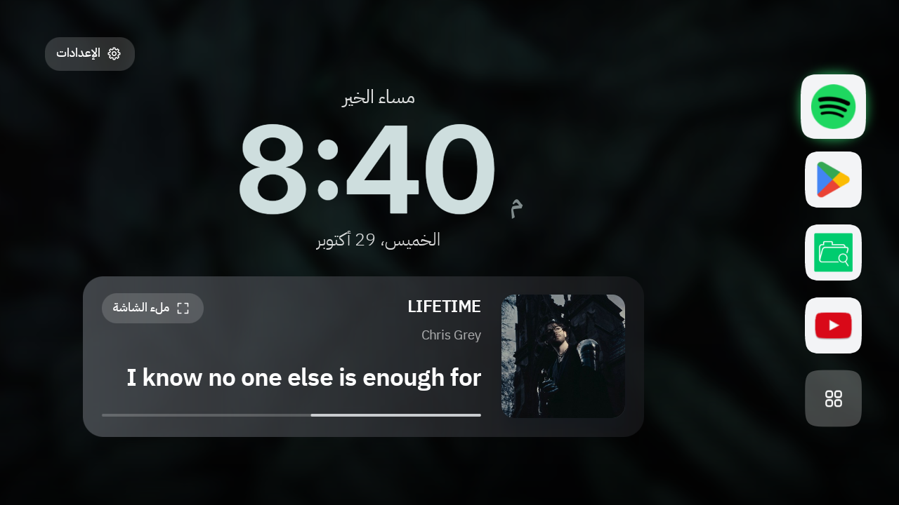</td>
    <td width="50%">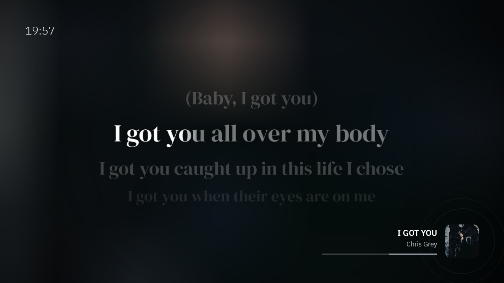</td>
  </tr>
  <tr>
    <td><b>A quiet home screen.</b> A large clock, the date (Gregorian or Hijri), a greeting, the song that is playing,
    and your apps in a dock along the bottom or down the side.</td>
    <td><b>Lyrics, in time.</b> When music plays (Spotify or any other app), the words appear in time with the song and
    light up as they are sung. Every song gets its own colours from its cover and its own typeface.</td>
  </tr>
  <tr>
    <td>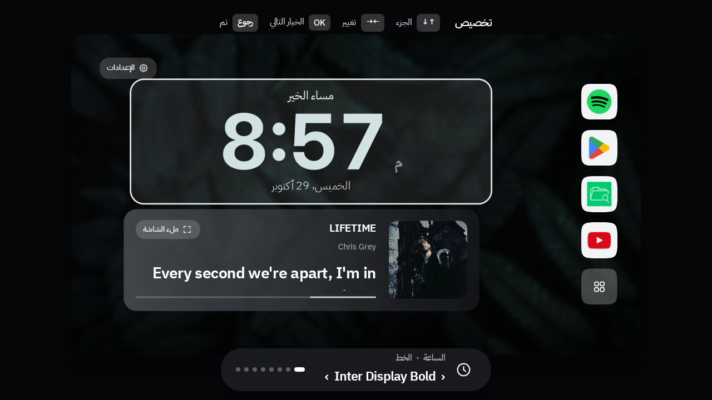</td>
    <td>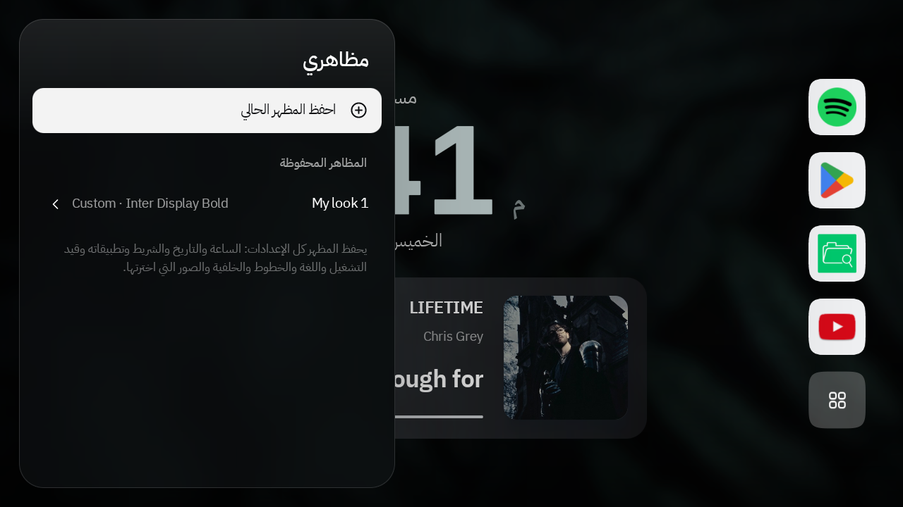</td>
  </tr>
  <tr>
    <td><b>Customize with the remote.</b> Like the iPhone lock screen editor: pick a part, then change it with left and
    right. Thirteen clock faces, stacked or outlined clocks, Arabic digits, four dock styles, wallpaper dim and blur,
    and five ready looks.</td>
    <td><b>My looks.</b> Save your home screen as it is, wallpaper and apps included, and bring it back any time.
    Trying another look never loses yours: the last change can always be undone.</td>
  </tr>
</table>

Also:

- **76 wallpapers in six sets** (dusk, mist, desert, earth, space, gradients), changeable from the TV. Pick single
  photos into **My picks**, or put your own folders in `/sdcard/Wallpapers`.
- **The song that is playing**, even on low-memory boxes where Android blocks the usual way to read it.
- **The whole interface in English or Arabic**, right to left in Arabic.
- **A lyrics screensaver**, and fast animations across the system.

## Updates

Sukoon never updates by itself. When you want to, open **Settings**, **About**, **Check for updates**. It shows the
new version, its size and what changed. If you go ahead, it downloads the file and checks it: the size, the
checksum GitHub publishes, that it is Sukoon, that it is newer, and that it is signed with the same key as your
copy. Then Android asks you to confirm, keeps all your settings, and Sukoon comes back by itself.

<p align="center">
  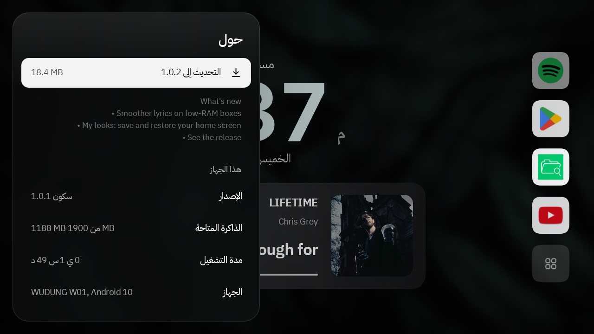
  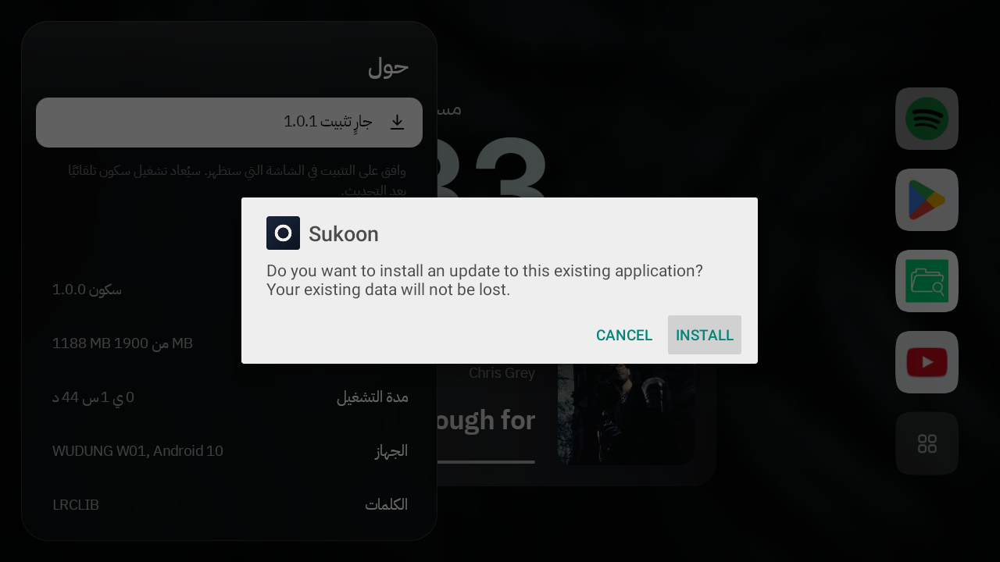
</p>

## Permissions and privacy

Sukoon asks for nothing you didn't grant over ADB, and each feature hides itself when its permission is missing.

| Permission | Why |
|---|---|
| Notification access | Read the song that is playing, on most TVs |
| DUMP | Read the song that is playing on low-memory TVs, through `dumpsys media_session` only |
| WRITE_SECURE_SETTINGS | Set the lyrics screensaver and the animation speed from Sukoon's settings |
| GET_USAGE_STATS | Sort apps by recent use |
| RECORD_AUDIO | Let the lyrics react to the music's beat (Android's Visualizer); nothing is recorded or stored |
| READ_EXTERNAL_STORAGE | Show your own photos from `/sdcard/Wallpapers` |
| REQUEST_INSTALL_PACKAGES | Install an update you chose; Android still asks you first |
| SYSTEM_ALERT_WINDOW | Bring the home screen back right after an update |

To find lyrics, Sukoon sends the song title and artist to [LRCLIB](https://lrclib.net). When a song has no cover or
length, it asks the iTunes Search API with the same two things. The optional weather comes from
[Open-Meteo](https://open-meteo.com). Nothing else leaves the TV.

## Undo everything

[`scripts/restore.sh`](scripts/restore.sh) turns every app back on, puts your old home screen and settings back,
and takes back every permission. To undo by hand, turn your TV's home screen back on and remove Sukoon:

```bash
adb shell pm enable com.google.android.tvlauncher
```

```bash
adb uninstall dev.multix.tvhome
```

## Build it yourself

The launcher is plain Kotlin with Android Views, about 1.7 MB without the wallpapers. Building, signing and
releasing are covered in [launcher/README.md](launcher/README.md).

## Credits

- **Wallpapers**: Featured Pictures from Wikimedia Commons and NASA, ESA, ESO and EHT images, under their
  licenses. Every file, author and license is listed in [wallpapers/ATTRIBUTION.md](wallpapers/ATTRIBUTION.md).
  The gradients set is generated.
- **Fonts** (SIL Open Font License): Inter, IBM Plex Sans Arabic, DM Serif Display, Bebas Neue, Space Grotesk,
  JetBrains Mono, Playfair Display, Outfit, Readex Pro, Noto Kufi Arabic and Cairo. Licenses in
  [launcher/licenses](launcher/licenses).
- **Lyrics**: [LRCLIB](https://lrclib.net). **Weather**: [Open-Meteo](https://open-meteo.com).
- Screenshots show Chris Grey's songs playing from Spotify.
